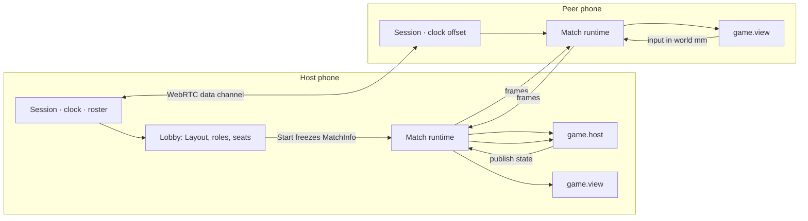

<h1 align="center">MobileGameConnect</h1>

<p align="center">
  Lay a few phones next to each other on a table. They become one screen.<br>
  Open-source platform for party games that run <em>across</em> phones, and an SDK to build your own.
</p>

<p align="center">
  <a href="https://github.com/Manubown/Bezel/actions/workflows/pages.yml"></a>
  <a href="https://manubown.github.io/Bezel/"></a>
  <a href="LICENSE"></a>
  
  
</p>

---

## Try it in two minutes

1. Open **<https://manubown.github.io/Bezel/>** on one phone. It becomes the **Host** and shows a QR code.
2. Scan the QR with the other phones (or open the same address and type the 4-letter code).
3. Lay the phones in a row, pick a Game in the Host's sheet, press **Start**.

Every phone needs internet for the first handshake (signaling); the game itself runs phone-to-phone over WebRTC. Away from Wi-Fi, one phone's hotspot carries everything. On iOS, **Share → Add to Home Screen** installs it full-screen. Details and what can go wrong: [Running on phones](docs/guide/running-on-phones.md).

## What it is

- **A shared play surface.** The phones' screens are Tiles in one world measured in millimetres; a ball that leaves one phone arrives on the next at the right place and time.
- **No install, no server.** A PWA; one phone is the Host and owns the clock and the game state; the others connect to it over WebRTC data channels. Serverless signaling via [Trystero](https://github.com/dmotz/trystero).
- **Games are plugins.** A Game is a package that imports `@mgc/sdk` only: a manifest, a `host()` factory that runs on the Host, a `view()` factory that runs on every phone. The platform does lobby, roles, clock, layout, input routing, pause and results.

## Games

| Game | Phones on the table | Phones in hand | Players | Built to prove |
|---|---|---|---|---|
| **Pong** | 1–4 in a row | – | 2 (bots) | a ball crossing bezels; the reference tick-driven Game |
| **Pass** | 1–4 | 1 | 1–4 | a Controller passed between Players; Holders, timers, DOM view |
| **Tap Race** | 1–4 | – | 1–4 (bots) | the tutorial Game: event-driven host, seats, timers |
| **Snake** | 1–4, any arrangement | – | 1–2 (bots) | a continuous world over rotated Tiles at 30 Hz |
| **Quiz** | 1 board | 1–4 | 1–4 | one Player per Controller phone, private DOM views, targeted state |
| **Air Hockey** | 1–2 facing each other | – | 2 (bots) | 2D paddles and prediction under 180° rotation |
| **Breakout** | 1–4, row or grid | – | 1–4 (bots) | a grid Layout, large change-only state, fan-out |

`games/_template` is the smallest complete Game ("Taps"); `pnpm new-game` copies it.

## Quick start (development)

Requires **Node 22** and **pnpm 10** (`corepack enable` picks the pinned version up from `package.json`).

```sh
git clone https://github.com/Manubown/Bezel.git
cd Bezel
pnpm install
pnpm dev          # Vite, https://<your-LAN-ip>:5173 (self-signed cert: accept it once per phone)
```

Open the printed `Network` address on the Host phone (not `localhost`: the QR encodes the Host page's own URL), scan it from the others. No phones at hand? Open several browser windows: the Host at `https://localhost:5173/`, each Peer at `https://localhost:5173/?room=CODE`.

```sh
pnpm test         # vitest across packages/, games/, apps/
pnpm typecheck    # tsc in every workspace package
pnpm build        # the PWA into apps/pwa/dist (BASE_PATH=/sub/path/ for a sub-path host)
```

## Build a Game

```sh
pnpm new-game tap-race "Tap Race"      # copies games/_template → games/tap-race
pnpm install --no-frozen-lockfile      # links @mgc/sdk into it
pnpm vitest run games/tap-race         # its test runs in one process, no phones
pnpm dev                               # it is in the Host's Game list with ?maker; nothing to register
```

A Game is ~100 lines: a manifest (how many Tiles, Controllers, Players), a host that reacts to `onInput`/`tick` and calls `ctx.publish(state)`, and a view that draws the latest state in world millimetres. Start at the **[Developer guide](docs/guide/README.md)**: [Getting started](docs/guide/getting-started.md) → [Your first Game](docs/guide/your-first-game.md) → [Concepts](docs/guide/concepts.md) → [API reference](docs/guide/api.md).

## How it works



- **Transport** (`@mgc/core`): Trystero matchmaking, then a star of WebRTC data channels with the Host at the centre; an in-memory transport for tests.
- **Clock** (`@mgc/core`): NTP-style sampling with a min-RTT filter gives every phone the Host's time to within a few milliseconds.
- **Layout** (`@mgc/layout`): a template (row, column, grid) places each phone's screen as a Tile in world millimetres; `Surface` maps world mm to that phone's pixels.
- **SDK** (`@mgc/sdk`): `defineGame({ manifest, host, view })`; `runMatch()` on every phone; host and view talk over a versioned, JSON-only wire so the same Game runs in-process today and in a sandboxed iframe later (M3).

Deeper: [Architecture](docs/architecture.md) · [SDK contract](docs/sdk-design.md) · [Decisions (ADRs)](docs/adr/) · [Glossary](GLOSSARY.md).

## Repository

```
apps/pwa/          the Host + Peer PWA: lobby, HUD, session log, runs the picked Game on every phone
packages/core/     transport (WebRTC via Trystero, in-memory for tests), clock sync, Session
packages/layout/   shape templates, Surface (world mm ↔ screen px)
packages/sdk/      the Game API (defineGame, runMatch), in-process link, wire types, test harness (@mgc/sdk/test)
games/             one package per Game; games/_template is the starter
scripts/           new-game.mjs (scaffold a Game), stable.mjs (move the `stable` release tag)
docs/              developer guide, architecture, design docs, ADRs, phone session logs
.scratch/          the in-repo issue tracker: specs, tickets and friction logs per feature
```

## Documentation

| Read | For |
|---|---|
| [docs/guide/](docs/guide/README.md) | building, testing, running and debugging a Game |
| [docs/architecture.md](docs/architecture.md) | how the packages fit together and where a Match's data flows |
| [docs/sdk-design.md](docs/sdk-design.md) | the `@mgc/sdk` contract: ordering, errors, wire protocol |
| [docs/adr/](docs/adr/) | the five binding decisions |
| [docs/PLAN.md](docs/PLAN.md) | research, prior art, milestones |
| [GLOSSARY.md](GLOSSARY.md) | the domain terms, used exactly throughout |
| [CONTRIBUTING.md](CONTRIBUTING.md) | checks, conventions, the issue tracker, releases |

## Status and roadmap

| Milestone | State |
|---|---|
| M0 Two phones, QR join, shared clock | ✅ done (rtt 5–8 ms on phones, offset error ≤ 2 ms) |
| M1 Shape-template Layout + Surface | ✅ done (grid lines continue across bezels) |
| M2 Pong across bezels on `@mgc/sdk`, in-process | ✅ done; seven Games built on it |
| Live test on real phones | ✅ 2026-11-07, findings and fixes shipped ([.scratch/live-test-1](.scratch/live-test-1/findings.md)) |
| Connectivity round 1: 1 Hz heartbeat, `weak`/`lost` links, a Peer reconnects through a Match, Host lobby survives a reload | ✅ 2026-11-08 ([.scratch/connectivity-1](.scratch/connectivity-1/spec.md)); star-only transport decided after the next phone run |
| Connectivity round 2: TURN servers from the build (`pnpm setup-turn`), relay-only after three failed attempts, state-arrival figures in the log, Pong's ball follows its path through a stall, a Host that stops signaling its own addresses after a failed connection | built 2026-11-10 and 11-11; the relay shown working on an iPhone hotspot (run 5), the Host fail-safe not yet run on phones ([.scratch/connectivity-2](.scratch/connectivity-2/spec.md)) |
| M3 Sandboxed Game bundles (iframe + `postMessage`), no Game source change | next |
| M4 Cross-bezel swipe alignment | planned |
| M5 Offline fallback (QR SDP), star-only transport | planned |

Two hosted builds exist: **/Bezel/** is `master`; **/Bezel/stable/** is the commit the `stable` git tag points at, a known-good build to fall back on (`pnpm stable <ref>` moves it). Every phone keeps a session log; in Maker mode (`?maker`), **Export log** on the Host's sheet shares it as NDJSON.

## Contributing

Issues, friction logs and tickets live in the repo under `.scratch/<feature>/` (see [docs/agents/issue-tracker.md](docs/agents/issue-tracker.md)). Before a PR: `pnpm typecheck && pnpm test`, and a Game must import `@mgc/sdk` only. More in [CONTRIBUTING.md](CONTRIBUTING.md).

## License

[MIT](LICENSE)
