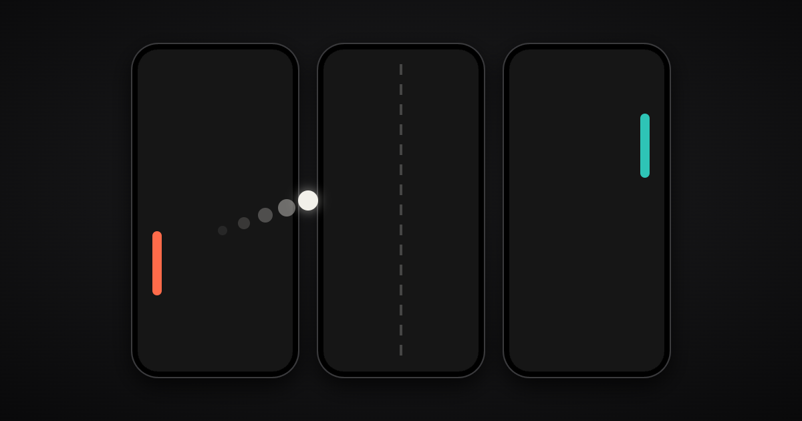

<h1 align="center">Bezel</h1>

<p align="center">
  <b>Put your phones side by side and they become one game board.</b><br>
  Free party games that run across several phones at once, in the browser. Nothing to install.
</p>

<p align="center">
  <a href="https://manubown.github.io/Bezel/play/">
    
  </a>
</p>

<p align="center">
  <a href="https://manubown.github.io/Bezel/play/"><b>Start a table</b></a> ·
  <a href="#build-a-game">Build a game</a> ·
  <a href="CONTRIBUTING.md">Contribute</a> ·
  <a href="https://github.com/Manubown/Bezel/issues/new/choose">Report a problem</a>
</p>

<p align="center">
  <a href="https://github.com/Manubown/Bezel/actions/workflows/pages.yml"></a>
  <a href="https://manubown.github.io/Bezel/play/"></a>
  <a href="LICENSE"></a>
</p>

## Try it now

<!-- docs/media/qr-play.svg holds brand.json's address + "play/"; made with the qrcode package the app uses:
     node apps/pwa/node_modules/qrcode/bin/qrcode -t svg -o docs/media/qr-play.svg "$(node -p "require('./brand.json').address")play/" -->


1. **One phone opens a table.** Scan this QR code, or open **manubown.github.io/Bezel/play** on it. It becomes the first phone and shows a QR code and its table's 4-letter code.
2. **The other phones join.** Scan the first phone's QR code with the camera. Or open the same address and type the code under "Join a different table" at the bottom.
3. **Lay the phones as the first phone shows, pick a game, press Start.** Every phone shows where it goes ("Lay me first, on the left"). Pong wants the phones in a row; Air Hockey puts two end to end.

Every phone needs the internet for the first seconds, so the phones can find each other. Then the game runs from phone to phone, or through a Relay server when no direct path works. After the first finished game the app offers to go on the home screen, where it opens full screen; on an iPhone: **Share → Add to Home Screen**.

## Works on

Run on real phones by the makers ([live runs 1–6](.scratch/live-test-1/findings.md), 2026-11-07 to 2026-11-10; [plan §6](docs/PLAN.md#6-milestones)):

| Phone | Browser | As |
|---|---|---|
| iPhone 15 Pro Max | Safari 27.2 | first phone and joining phone |
| iPhone 12 | Safari 27.2 | joining phone |
| iPhone 14 | Safari 26.6.1 | joining phone |
| an Android 15 phone | Firefox 159 | first phone |
| two Android phones, one more iPhone | not recorded | joining phones (live run 1) |

Untested: Chrome and every other Android browser but Firefox (the logs do not say which one the two Android phones of live run 1 used), other browsers on iPhone, iPads and other tablets. Each run used the build of its day; nothing built after live run 6 has been run on phones yet.

## Known limits

- **iPhone Personal Hotspot.** When the first phone is an iPhone sharing its hotspot and another iPhone joins it, the direct connection often dies within a second, again and again: by WebKit's source, Safari on the hotspot phone offers only its mobile-data address ([why](docs/research/README.md)). A build with a Relay gets the phone in through it after about 20 s, and over the Relay the game's updates can arrive up to a second late. Use the same Wi-Fi on every phone, or mobile data on every phone. An Android phone's hotspot is reported to work by one outside source; the makers have not run it.
- **No offline play.** The phones need the internet to find each other, and the app is not kept on the phone for offline use.
- **Screen sizes are estimated.** A browser does not tell a page how many millimetres its screen measures, so the app assumes one pixel density per kind of phone ([`device.ts`](apps/pwa/src/device.ts)). Between phones of different sizes the picture may not line up exactly across the gap.
- **Early project.** Things break. [Tell us](https://github.com/Manubown/Bezel/issues/new/choose) which phones you used.

## What you can play

| Game | Phones on the table | Players |
|---|---|---|
| **Pong** | 1–4 in a row | 2; a bot can take either paddle |
| **Air Hockey** | 1–2, end to end or side by side | 2; a bot can take either end |

In Maker mode (add `?maker` to the address) the first phone also lists five Games built as examples of the SDK:

| Game | Phones on the table | Phones in hand | Players | What it shows a maker |
|---|---|---|---|---|
| **Pass** | 1–4, any arrangement | 1 | 1–4 | a phone in hand passed between Players: Holders, timers, a DOM view |
| **Tap Race** | 1–4, any arrangement | – | 1–4, bots | the tutorial Game: an event-driven host, seats, timers |
| **Snake** | 1–4, any arrangement | – | 1–2, bots | one world over every arrangement, at 30 Hz |
| **Quiz** | 1, the board | 1–4 | 1–4, one per phone in hand | private DOM views, a state sent to one phone only |
| **Breakout** | 1–4, in a row or a grid | – | 1–4, bots | a grid Layout; a large wall sent only when it changes |

`games/_template` is the smallest complete Game ("Taps"); `pnpm new-game` copies it.

## How it works

One phone opens the table: it runs the game and keeps the clock, and every other phone talks only to it. The phones find each other once through public signaling relays, then connect directly over WebRTC, or through a Relay server when no direct path works. Each screen is a Tile in one shared world measured in millimetres, so a ball that leaves one phone arrives on the next at the right place and time.

The diagram and the details: [Architecture](docs/architecture.md) · [SDK contract](docs/sdk-design.md) · [Decisions (ADRs)](docs/adr/) · [Glossary](GLOSSARY.md) · [all docs](docs/README.md).

## Build a Game

```sh
pnpm new-game my-game "My Game"      # copies games/_template → games/my-game
pnpm install --no-frozen-lockfile    # links @mgc/sdk into it
pnpm vitest run games/my-game        # its test runs in one process, no phones
pnpm dev                             # it is in the first phone's list with ?maker; nothing to register
```

The smallest Game is about 100 lines: a manifest (how many phones on the table and in hand, how many Players), a host that reacts to `onInput`/`tick` and calls `ctx.publish(state)`, and a view that draws the latest state in world millimetres. Start at the **[Developer guide](docs/guide/README.md)**: [Getting started](docs/guide/getting-started.md) → [Your first Game](docs/guide/your-first-game.md) → [Concepts](docs/guide/concepts.md) → [API reference](docs/guide/api.md).

## Develop locally

Requires **Node 22** (22.23.4 or newer to build the site) and **pnpm 10** (`corepack enable` picks the pinned version up from `package.json`).

```sh
git clone https://github.com/Manubown/Bezel.git
cd Bezel
pnpm install
pnpm dev          # Vite, https://<your-LAN-ip>:5173 (self-signed certificate: accept it once per phone)
```

Open the printed `Network` address on the first phone (not `localhost`: the QR code carries the first phone's own address), scan it from the others. No phones at hand? Open several browser windows: the first phone at `https://localhost:5173/`, each other phone at `https://localhost:5173/?room=CODE`.

```sh
pnpm test         # vitest across packages/, games/, apps/
pnpm typecheck    # tsc in every workspace package but the site
pnpm build        # the app into apps/pwa/dist (BASE_PATH=/sub/path/ for a sub-path host)
```

```
apps/pwa/          the app: lobby, sheet and strip, session log; runs the picked Game on every phone
apps/site/         the site in front of it (Astro); scripts/pages.mjs builds both for GitHub Pages
packages/core/     transport (WebRTC via Trystero, in-memory for tests), clock sync, Session
packages/layout/   templates (row, column, grid), Surface (world mm ↔ screen px)
packages/look/     the night-table look: colour and type tokens and the display face, for the app and the site
packages/sdk/      the Game API (defineGame, runMatch), wire types, test harness (@mgc/sdk/test)
games/             one package per Game; games/_template is the starter
docs/              developer guide, architecture, design docs, ADRs, research, phone session logs
.scratch/          the makers' design notes and work logs
```

## Contribute

- **A problem at the table, or an idea for a Game:** [open an issue](https://github.com/Manubown/Bezel/issues/new/choose); a form asks for what helps. Security problems go privately: [SECURITY.md](SECURITY.md).
- **Code:** read [CONTRIBUTING.md](CONTRIBUTING.md). Before a pull request: `pnpm typecheck && pnpm test`, and a Game imports `@mgc/sdk` only.
- Everyone here follows the [Code of Conduct](CODE_OF_CONDUCT.md). What changed for players: [CHANGELOG.md](CHANGELOG.md).
- [`.scratch/`](.scratch/README.md) holds the makers' design notes and work logs; you do not need it to report or contribute.
- [`AGENTS.md`](AGENTS.md) and [`docs/agents/`](docs/agents/) tell AI coding agents this repository's conventions.

## Status

- **Players get:** one phone opens a table, the others join by QR code, and Pong or Air Hockey runs across them as one board; a phone that drops out pauses the game until it is back.
- **Makers get:** seven Games on the SDK (five of them examples in Maker mode), `pnpm new-game`, and a test harness that runs a Match in one process.
- **Connecting:** direct WebRTC, or a Relay after three failed tries in a build that has one; the fail-safe for an iPhone hotspot (the first phone stops signaling its own addresses) is built but has not been run on phones.
- **Not built:** offline play, Games sandboxed in their own frames, aligning the phones with a swipe.
- **Builds:** [`play/`](https://manubown.github.io/Bezel/play/) is the build the `stable` tag points at, moved after a good run on phones; [`next/`](https://manubown.github.io/Bezel/next/) is the latest. Milestones: [docs/PLAN.md §6](docs/PLAN.md#6-milestones).

## Privacy

There are no accounts, no cookies, no analytics and no ads; the app loads nothing from other sites, and nothing goes to the makers. GitHub Pages, which serves the site and the app, sees your phone's IP address. To find each other, the phones of a table talk to five public Nostr relays, which see the IP address, a scrambled form of the table's name and each phone's offer to connect, locked with a key made from the table's code; and to Google's and Cloudflare's STUN servers, which tell a phone its own public address. In a build with a Relay (the hosted builds of this code use Metered's), each phone asks the Relay for a way through whenever it sets up a connection, so Metered sees its IP address; the encrypted game passes through the Relay only when no direct path works. The other phones of the table see your IP address, as in any direct connection, and the kind of phone, its screen size, its Device and Player ids and the names typed in. Your phone keeps those ids, a few settings (Maker mode, sound, the last game picked on the first phone, how many games it finished and whether the install offer was closed), on the first phone its table until the tab closes, and a session log, all in its browser; the log leaves the phone only if someone exports it. In full, with how to delete it: the site's [privacy page](https://manubown.github.io/Bezel/privacy/).

## Licence

[MIT](LICENSE). The name is Bezel; the packages in this repository keep the `@mgc` scope (and Game ids `mgc.<slug>`) from the project's first name, MobileGameConnect.
