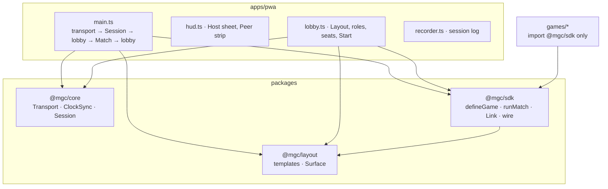
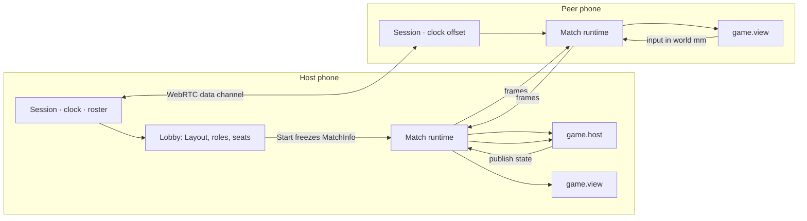
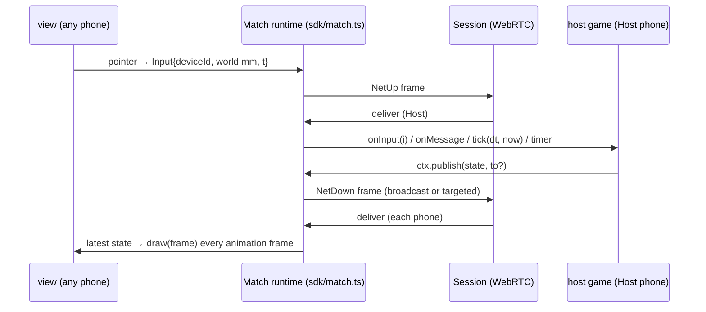

# Architecture

How the packages fit together and where a Match's data flows. The code is the source of truth; every section names the file to read next. For the SDK contract in full (ordering, errors, wire frames) read `docs/sdk-design.md`; for the terms, `GLOSSARY.md`; for why, `docs/adr/`.

## 1. The shape

Dependency rules. The arrows are the only ones the `package.json` dependencies allow; every Game's test additionally scans its own sources and fails on any specifier but `@mgc/sdk`:

| Package | May import | Never imports |
|---|---|---|
| `@mgc/core` | `trystero` | anything in the repo |
| `@mgc/layout` | – | `core` (ADR-0005: the Layout is pure millimetre math) |
| `@mgc/sdk` | `@mgc/layout` (re-exports `Surface`, `Vec2`, `Rect`); `@mgc/core` in its tests only | `core` at runtime: the SDK never sees a transport |
| `games/*` | `@mgc/sdk` | `core`, `layout`, `apps/pwa` (each Game's "imports nothing but the SDK" test) |
| `apps/pwa` | all three packages, `games/*` via discovery | – |

The site (`apps/site`) imports from `@mgc/pwa` only the modules that `apps/pwa/package.json`'s `exports` name (`games`, `gamelist`, `install`, `join`, `sessioncode`, the files in `public/`). Each is pure when loaded: no DOM, no storage, no state, nothing that runs on import, so the site renders them at build time and in its own few scripts. The lobby, the HUD and `main.ts` hold state and are never exported.

## 2. One phone, from page load to a running Game (`apps/pwa/src/main.ts`)

1. **Identity.** `claimDeviceId()` (`device.ts`) gives the tab a persisted `DeviceId`; `deviceInfo()` measures the screen (CSS px, `dpr`, a `pxPerMm` heuristic per platform, corrected for Safari Page Zoom).
2. **Room.** No `?room=` in the URL → this tab is the **Host** with a 4-letter code (kept in `sessionStorage` across reloads). `?room=CODE` → a **Peer**. A build that carries TURN servers (`VITE_MGC_TURN_SERVERS`, read by `turn.ts`) adds them to the ICE servers as a fallback (ICE prefers the direct pair); `?noturn` leaves them out and travels in the QR to every Peer.
3. **Transport.** `TrysteroTransport` (`packages/core/src/trystero-transport.ts`): Trystero matches the phones over public Nostr relays, then opens WebRTC data channels. With TURN servers, a transport that was reset three times in a row without a connection that lasted joins through the relay only (`relay-escalation.ts`), and goes back to every path if the relay does not connect. The recorder wraps the transport to log bytes and ICE state.
4. **Session.** `hostSession()` / `joinSession()` (`packages/core/src/session.ts`) return the same `Session` interface for both roles: `roster()`, `send(channel, data, to?)`, `onMessage`, `clock.now()`, `onDeviceLost/Back`. Peers only ever talk to the Host; the Host stamps and relays. A Peer is `searching` → `syncing` → `ready`; the Host is always `ready`. The 1 Hz clock pings double as the heartbeat: a connection silent for 2.5 s is `weak` in the roster (`RosterEntry.link`), for 5 s `lost` (the Host drops it, `onDeviceLost`); a Peer that loses its Host, or is greeted but not `ready` within 4 s, turns `reconnecting`, resets its transport (`Transport.reset()`: leave and rediscover) and goes `syncing` → `ready` again when a Host greets it. The Host never resets.
5. **Clock.** `ClockSync` samples the Host NTP-style, keeps the min-RTT samples, and `SharedClock.now()` is the Host's time on every phone (`packages/core/src/clock.ts`).
6. **Lobby** (`apps/pwa/src/lobby.ts`). The Host's lobby decides, Peers mirror it over the `lobby` channel: which Devices are Tiles vs Controllers, the Tile order, the template (`row` / `column` / `grid` → `buildLayout()` in `@mgc/layout`), the picked Game, and who plays (seats: at the first and last Tile by default, or one Player per Controller when the Game's manifest says `seats: 'controllers'`). The Host's **Start** validates against the manifest and deep-freezes a `MatchInfo` (ids, seed, `tickHz`, Players, Devices, Tiles, bounds) that every Device receives verbatim.
7. **Match.** Each Device calls `runMatch()` (`packages/sdk/src/match.ts`) with the frozen `MatchInfo`, a `Link` to the Game, and `send`/`deliver` wired to the Session's `match` channel. The Host also runs the Game's `host()`; every Device, the Host included, runs the Game's `view()`. `pauseOnDeviceLoss()` pauses the Match while a Device is gone and resumes when it is back. When the Match closes (ended, aborted, fault, link lost), the lobby reopens on every Device.
8. **Log.** `recorder.ts` keeps an NDJSON session log in IndexedDB (connectivity, ICE, clock samples, roster, Match events, faults, wire bytes, fps); the HUD exports it. `docs/liveLogs/` holds the logs of the live runs on phones (`docs/liveLogs/README.md`).

The same path on two phones, from the Session to a running Match:

The clock (step 5) gives every phone the Host's time to within a few milliseconds: an offset error of at most 2 ms between two browser tabs, rtt 5–8 ms between phones (`docs/PLAN.md` §6, M0).

## 3. Inside a Match: the SDK seam (`packages/sdk`)

- **Two factories.** `defineGame({ manifest, host, view })` (`game.ts`). `host(ctx)` runs once on the Host: reacts to `onInput`, `onMessage`, `tick` (fixed step at `manifest.tickHz`, default 60; `0` = event-driven), timers; calls `ctx.publish(state)`, `ctx.setHolder`, `ctx.end(result)`. `view(ctx)` runs once per Device: `draw({ ctx, state, tile, … })` in world millimetres on a canvas the runtime owns, or `mount` for a DOM view; `ctx.send(msg)` back to the host.
- **The Link** (`wire.ts`). Host game and view game each talk to the runtime through a `Link` of versioned JSON frames (`WIRE_VERSION`): `init`, `tick`, `input`, `msg`, `timer`, `holders`, `clock`, `pause`, `resume`, `close`, `reject`. Every adapter `structuredClone`s every frame, so a Game that works in-process (`inProcessLink`, M2) works unchanged in a sandboxed iframe (M3, ADR-0004).
- **State is a stream, not lockstep** (ADR-0003). One `publish` = one wire frame; views keep the latest state and extrapolate if they want. No determinism is required of a Game. Host upload is `(N − 1) × tickHz × bytes`; Snake's manifest comment shows the arithmetic.
- **Pause.** A lost Device pauses the Match on every phone; timers are pause-aware; the resume frame re-anchors the clock and tells the Game how long it stood still (`onResume(now, pausedMs)`). A Peer runtime that starts or re-attaches mid-Match sends `hello`; the Host answers it alone with the Holders, the retained states and the pause, so it draws at once (connectivity-1 02).
- **Faults.** A throwing hook is a `fault` event; the runtime's ladder decides between carrying on, closing the view, and closing the Match (`match.ts`, `game-side.ts`).
- **Testing** (`testing.ts`, `headless.ts`, exported as `@mgc/sdk/test`). `createTestMatch()` runs host and every view in one process over a memory link with a fake clock and a headless screen; tests script fingers and assert states, events and results. `docs/guide/testing.md`.

## 4. World millimetres (`packages/layout`, ADR-0005)

A `Layout` is a set of `Tile`s `{ x, y, w, h, rot, deviceId }` in millimetres; `buildLayout(template, devices)` places the present Tiles with a default bezel gap; `Surface` maps world mm ↔ one Device's CSS px, including rotation. `pxPerMm` per Device comes from a UA heuristic (`apps/pwa/src/device.ts`) until calibration exists; it is the main source of visible misalignment between unlike phones.

## 5. Where a change goes

| You want to | Touch |
|---|---|
| a new Game | `pnpm new-game <slug> "<Name>"`, then `games/<slug>/src/index.ts`; nothing to register (`apps/pwa/src/games.ts` globs `games/*/src/index.ts`) |
| a new Game-facing capability | `packages/sdk/src/{types,game,wire,match,game-side}.ts`, the test harness, `docs/sdk-design.md`, `docs/guide/api.md` |
| a lobby rule (who may start, seats, templates) | `apps/pwa/src/lobby.ts` (+ `apps/pwa/test/lobby.test.ts`), the refusal messages quoted in `docs/guide/troubleshooting.md` |
| the Host sheet or Peer strip | `apps/pwa/src/hud/sheet.ts`, `apps/pwa/src/hud/strip.ts` (the result and pause cards: `hud/cards.ts`; `hud.ts` opens them), `apps/pwa/index.html` |
| the install offer and the in-app-browser banner | `apps/pwa/src/install.ts` (what to offer; `apps/pwa/test/install.test.ts`), `apps/pwa/src/installer.ts` (what the browser says, the prompt, the Device's count), `apps/pwa/src/hud/install.ts` |
| the public name, pitch or address | `brand.json` at the workspace root, nothing else: the build fills in `apps/pwa/index.html` and writes the web manifest from it (`apps/pwa/brand.ts`), the sheet and the strip import it. The icons and the link-preview picture are SVG sources and PNGs in `apps/pwa/public/` |
| the look (colours, type, the display face) | `packages/look/tokens.css`, once for the app and the site: every colour and face in `apps/pwa/index.html` is one of its tokens, and the canvas and the QR code read them through `apps/pwa/src/look.ts`. The contrast of every pair the screens use is checked in `packages/look/test/look.test.ts`. The ground (`--bg`) is also the manifest's and the browser bar's colour, and the icons and the preview picture are drawn on it: a new ground means rasterising them again |
| the site's pages | the home page `apps/site/src/pages/index.astro`, the privacy page and the imprint beside it, all in the one layout every page shares (`src/layouts/Page.astro`: the look's tokens, the display face, the icon, the link preview, the sitemap link, the name back home, the footer; a test holds every page to it), its drawings in `src/components/`. What it says about the app is the app's own: the Games players see with their card lines (`homeGames`, `apps/site/src/games.ts`, from `gamelist.ts`), the install steps and the in-app-browser banner (`install.ts`), the hotspot advice (`join.ts`), the join field's code rule (`sessioncode.ts`, `apps/site/src/join.ts`); `@mgc/pwa`'s `exports` name the modules the site may import. Tests in `apps/site/test/` |
| connectivity, clock, roster | `packages/core/src/{trystero-transport,session,clock}.ts` |
| another template or the mm math | `packages/layout/src/{templates,surface}.ts` |
| the hosted build | `.github/workflows/pages.yml`, `scripts/stable.mjs` |

## 6. Milestone map

| Milestone | Layer it changes | State |
|---|---|---|
| M0 clock + join | `core` | done |
| M1 templates + Surface | `layout` | done |
| M2 SDK in-process, Pong | `sdk`, `apps/pwa` lobby/Match | done; seven Games |
| Connectivity round 1: heartbeat, `link`, `reconnecting`, `Transport.reset()`, `hello` replay, `pausedMs`, rejoin through a reconnect, Host lobby persistence | `core` session/transport, `sdk` wire, `apps/pwa` rejoin/lobby | done 2026-11-08 (`.scratch/connectivity-1`) |
| M3 iframe bundles | `sdk` adds an iframe `LinkFactory`; Games unchanged | next |
| M4 swipe alignment | `layout` solver, `apps/pwa` gesture | planned |
| M5 offline signaling, star-only transport | `core` QR-SDP adapter or own signaling | planned; decided after the next phone run (connectivity-1 D6) |

`docs/platform-design.md` is the design that produced the `Session` interface and the lobby seam before M2; read it for the reasoning, this file for what exists.
